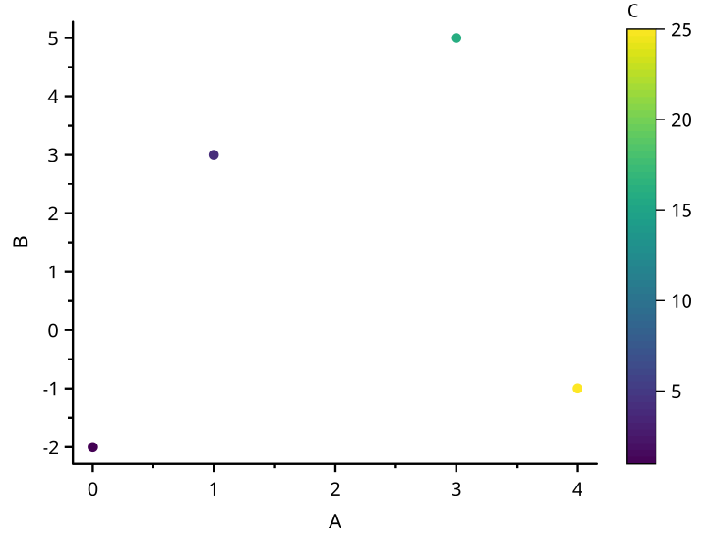
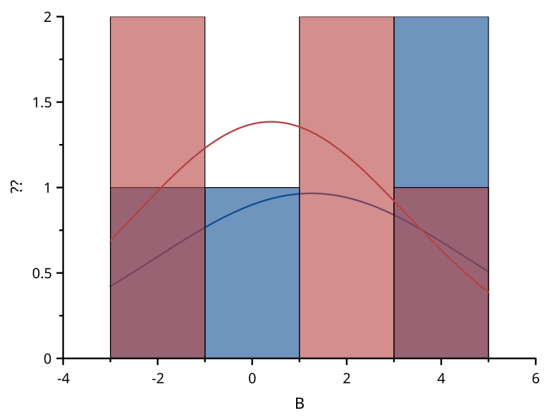
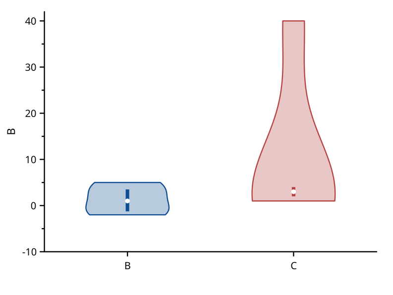
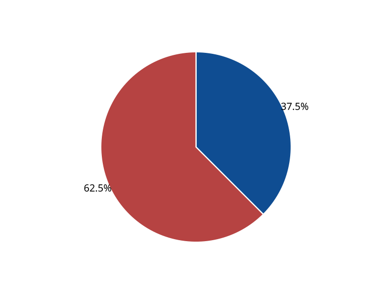

# SciCanvas

**用 Rust 开发的科研绘图与数据分析桌面软件。**

[](https://github.com/sch401/scicanvas/actions/workflows/ci.yml)
[](#许可证)

从工作表导入数据，完成拟合、统计和科研绘图，再将结果保存为项目或导出为图片、矢量图和报告。SciCanvas 提供独立文档窗口、选项卡式功能区、图型预览和撤销重做，支持浅色与深色界面。

当前为 **0.1 开发版**，开发和验收平台为 **Windows x64**。日常使用无需安装 Python，也无需连接云服务。

[快速上手](#快速上手) · [构建运行](#构建运行) · [示例项目](samples/README.md) · [功能进度](docs/parity/PARITY.md) · [反馈问题](https://github.com/sch401/scicanvas/issues)

## 主要功能

| 方向 | 已实现的能力 |
| --- | --- |
| 工作表 | CSV、文本和 Excel 导入，列角色与单位，公式、筛选、排序、查找替换，转置、堆叠、拆分和抽取 |
| 科研绘图 | 33 种基础图型，包括折线、散点、误差带、柱形、条形、面积、瀑布、气泡、直方图、Q-Q 图、箱线图、小提琴图、饼图和极坐标图，另支持表达式函数曲线 |
| 图形设置 | 多图层、双 Y 轴、七种坐标轴刻度、逐点颜色/大小/符号映射、色阶条、图形主题、文本和形状标注、填充图案 |
| 拟合 | 线性、多项式、38 个内置非线性模型及自定义函数，支持误差加权、固定参数、参数限制、线性约束、全局拟合、多峰拟合、模型比较和残差分析 |
| 分析与统计 | 平滑、插值、微分、积分、FFT、基线与寻峰，描述统计、相关性、正态性、离群值、KS 双样本检验及方差分析 |
| 项目与导出 | 工作表、图形和 Note 统一保存，图形/工作簿模板，批量绘图与导出，SVG、PDF、PNG、TIFF、CSV 和 Excel 输出 |

图形显示和出版导出共用场景排版，页面尺寸、曲线、文字和标注采用同一套几何计算。

### 绘图示例

下图来自仓库中的真实绘图用例。配套数据和 `.scv` 项目见 [samples](samples/README.md)。

| 颜色映射散点图 | 直方图与分布曲线 |
| --- | --- |
|  |  |

| 小提琴图 | 饼图 |
| --- | --- |
|  |  |

## 快速上手

1. 打开示例项目，或导入 CSV、文本、Excel 数据。
2. 设置 X、Y、误差列等角色，检查列名和单位，选中需要处理的列。
3. 在“绘图”选项卡中选择图型，或使用作图面板设置数据映射。
4. 在“分析”或“统计”中执行计算，在“图形”中调整坐标轴、图例和标注。
5. 保存 `.scv` 项目，或导出图形与数据。

每个工作簿对应一个独立工作表窗口。Excel 文件包含多张表时，会分别导入为独立工作簿。绘图命令作用于当前窗口：工作表激活时新建图形，图形激活时修改当前图层的图型。

| 快捷键 | 操作 |
| --- | --- |
| `Ctrl+S` | 保存项目 |
| `Ctrl+Z` / `Ctrl+Y` | 撤销 / 重做 |
| `Ctrl+K` | 搜索命令 |
| `Ctrl+F` | 查找 |
| `Ctrl+F1` | 折叠或展开功能区 |

## 构建运行

### 从源码运行

准备 Windows x64、Rust 1.88 或更新版本，以及安装了 Windows SDK 和“使用 C++ 的桌面开发”组件的 Visual Studio Build Tools。

```powershell
git clone https://github.com/sch401/scicanvas.git
cd scicanvas
cargo run --release --locked -p scicanvas
```

只编译程序：

```powershell
cargo build --release --locked -p scicanvas
```

编译结果为 `target/release/scicanvas.exe`。程序读取系统字体，中文显示默认使用 Windows 字体。可通过 `SCICANVAS_FONT` 指定本机字体文件。

### Windows 安装包

项目支持生成 **MSI 安装包**和**便携 ZIP**。当前尚未发布正式版本，可按 [安装包构建说明](installer/README.md) 自行打包；后续发布将放在 [Releases](https://github.com/sch401/scicanvas/releases)。

MSI 提供欢迎页、安装进度和完成提示，安装到当前用户的 `%LOCALAPPDATA%\Programs\SciCanvas`，添加开始菜单快捷方式，并注册项目及模板文件关联。

**运行程序不需要 Python。** Python 和 Node.js 用于开发检查，NumPy、SciPy、Matplotlib 等用于生成独立参考数据。Python 脚本控制台仍在后续计划中。

macOS 和 Linux 适配尚未验收，目前请使用 Windows 构建。

## 项目与文件格式

| 扩展名 | 用途 |
| --- | --- |
| `.scv` | 项目容器，保存数据、图形、Note 和预览 |
| `.scgt` | 图形模板 |
| `.scbt` | 工作簿模板 |
| `.scfn` | 自定义拟合函数 |

当前项目数据格式为 **v40**，支持读取旧版 v0–v39 项目。结构与迁移记录见 [项目文件格式](docs/PROJECT_FORMAT.md)。

## 开发与验证

- [`scicanvas-core`](crates/scicanvas-core)：数据模型、计算算法、项目读写及共享绘图场景。
- [`scicanvas`](crates/scicanvas)：基于 egui/eframe 的桌面界面与系统交互。
- [`tools`](tools)：检查、参考数据生成及发布打包脚本。

完整开发检查需要 Python 3.11+ 和 Node.js 20+：

```powershell
python tools/check.py
```

检查涵盖依赖安全与许可、文档和功能清单同步、Rust 格式、测试及 Clippy。数值结果使用 SciPy、NumPy、Matplotlib 和 NIST 数据进行对照，图形保留 SVG 基线与视觉用例。

- [贡献说明](CONTRIBUTING.md)：环境准备、检查和发布流程。
- [功能对照清单](docs/parity/PARITY.md)：已完成、待验收及后续范围。
- [NIST 拟合对照](docs/parity/nist.md)：认证数据集测试记录。
- [人工验收清单](docs/acceptance/README.md)：界面、安装及操作验证。
- [技术路线](docs/ROADMAP.md)：开发安排。

欢迎通过 [Issues](https://github.com/sch401/scicanvas/issues) 报告问题或提出需求。报告问题时，请附 Windows 版本、程序版本、复现步骤和必要的示例数据。

## 许可证

项目代码采用 [MIT](LICENSE-MIT) 或 [Apache-2.0](LICENSE-APACHE) 双许可证。第三方依赖、字体及素材遵循各自许可证，完整声明见 [THIRD_PARTY_NOTICES.md](THIRD_PARTY_NOTICES.md)。
