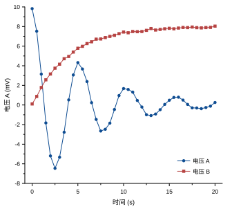
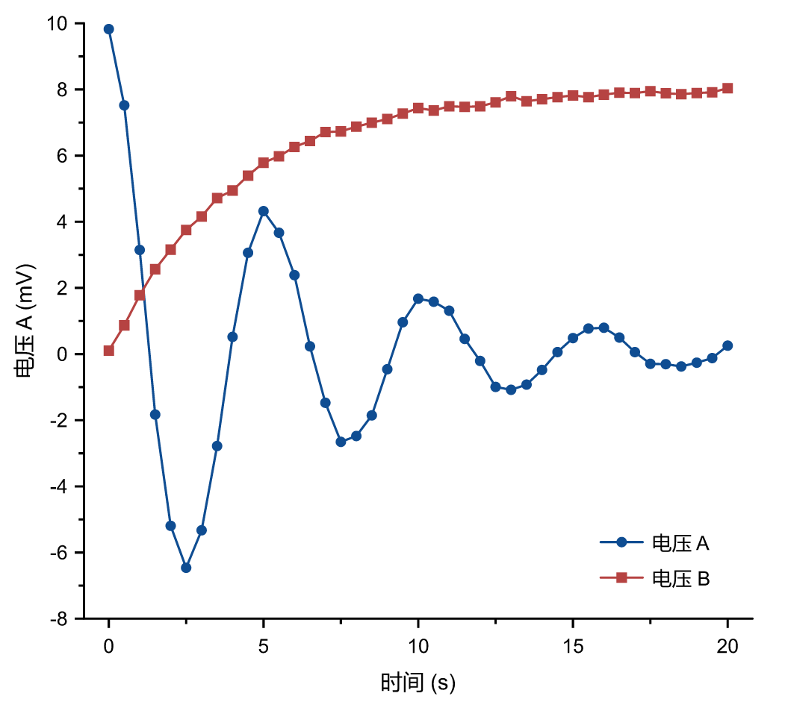

# 导出样例

覆盖：F227（PNG）、F228（PDF）。由 `crates/scicanvas/src/export.rs` 的 `update_export_samples`（忽略测试）在 Windows 上生成：示例项目第一张图，页面 89 × 80 mm（期刊单栏）。

| SVG（共用版面） | PNG（300 dpi） |
|---|---|
|  |  |

PDF：[sample.pdf](sample.pdf)，矢量，嵌入字体子集，可选中文字。

预期：PNG 为 1051 × 945 像素，pHYs 为 11811 像素/米（300 dpi）；PDF 页面为 252.28 × 226.77 pt。`committed_export_samples_keep_page_size_and_resolution` 在 CI 中核对已提交样例的尺寸与分辨率仍与当前导出一致。

复现：

    cargo test -p scicanvas --all-features update_export_samples -- --ignored

生成环境：Windows 11（10.0.26300），提交 `fbf4b31`。

结论：待审查目视复核。插入 Word 后的实际尺寸和打印效果属于 Windows 人工验收，见 docs/acceptance/import_export.md。
