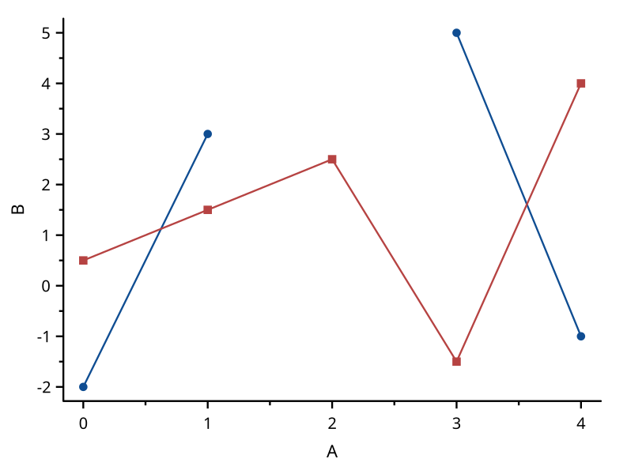
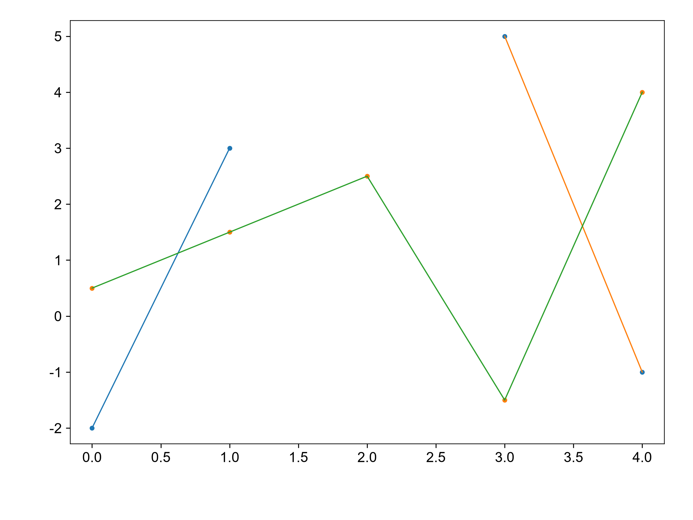

# add-remove-curve

覆盖：F083。数据来源：本仓库自建最小样例，构造见 tests/visual_cases.rs。先以 A 为 X 画 B、C 两条点线，再移除 C、加入 D；原始数据、轴范围和图元完整记录在 scicanvas.json。matplotlib 使用同一数据和轴范围，只画增删后剩下的 B、D。

| SciCanvas | matplotlib |
|---|---|
|  |  |

结论：增删曲线后剩余曲线的数据位置与刻度映射一致，visual_compare 按 1e-6 检查。图形风格差异见[总说明](../README.md)。复现环境和命令也见总说明。
