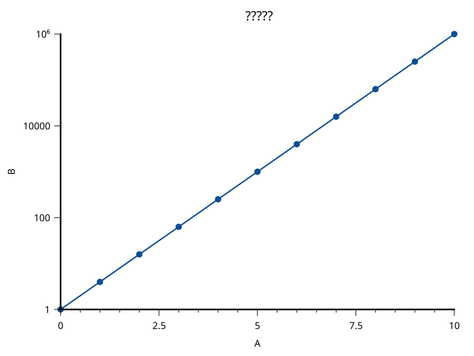
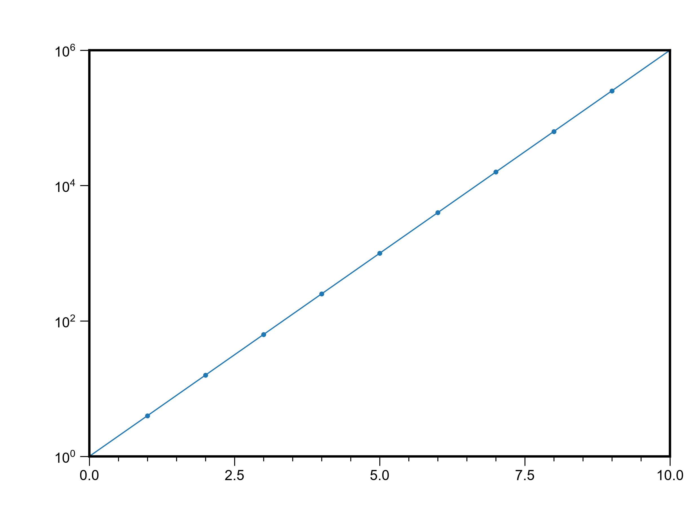
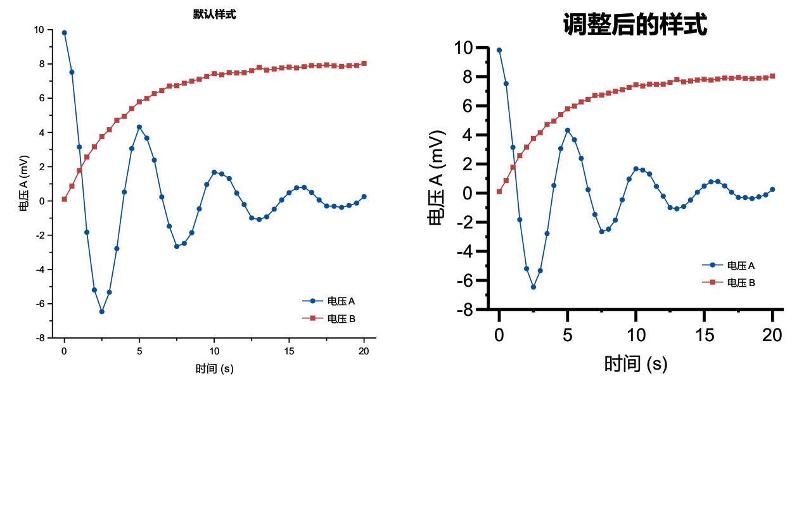

# 坐标轴外观与刻度（AX / F515）

使用同一组 X = 0–10、Y = 10^(0.6X) 数据。X 主间隔 2.5，每段 4 根次刻度；Y 为 Log10，每 2 个数量级一个主刻度，不画次刻度。Matplotlib 独立使用 MultipleLocator(2.5)、MultipleLocator(0.5)、LogLocator(base=100) 与 NullLocator 计算刻度，位置按 1e-6 对照。

| SciCanvas | Matplotlib |
|---|---|
|  |  |

## 默认与手动样式

同一张 89 mm 页面上的默认样式与手动样式对照，手动使用轴线 2 pt、主刻度 8 pt、刻度标签/轴标题 12 pt、图标题 16 pt。图片由实际屏幕渲染器离屏生成，背景透明。

尺寸为最终导出 pt；默认值继续随页面比例。极坐标和色阶条只接字号，本例不代表其间隔可自定义。
