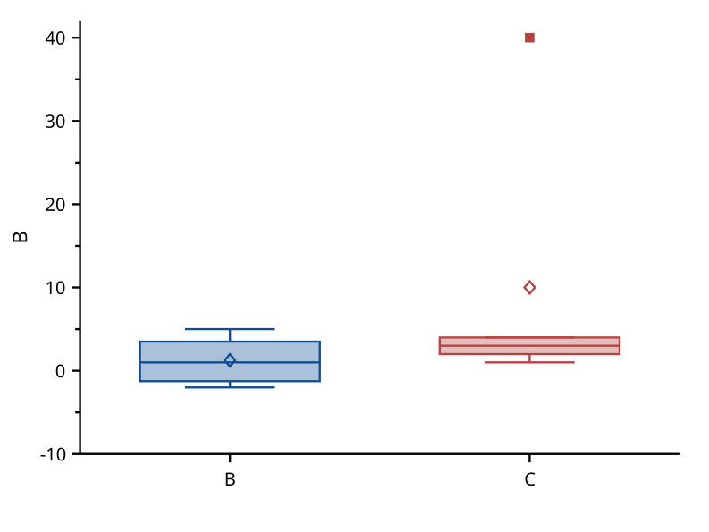
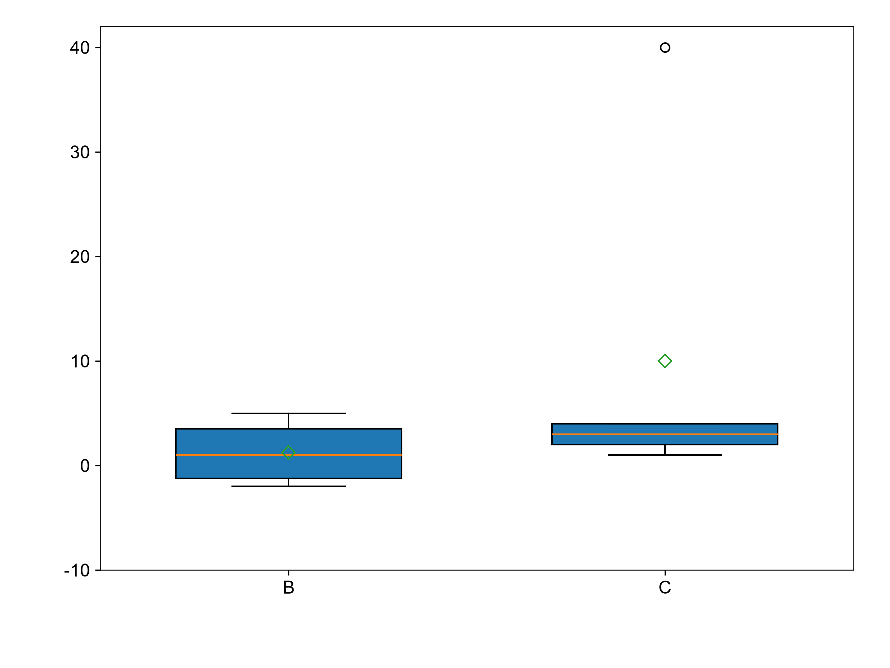

# box

覆盖：F341。B、C 两个 Y 列分别生成箱体，B 列含缺失值，C 列含一个离群点。每列剔除非有限值，采用线性插值四分位数、1.5 IQR 须线，空心菱形为均值。

| SciCanvas | matplotlib |
|---|---|
|  |  |

matplotlib 使用 `boxplot(whis=1.5, showmeans=True, widths=0.6)`。`visual_compare` 按 1e-6 比较箱体中心与高度、中位线、须线和须端横线、离群点与均值的位置。数值测试另按 1e-12 对照 `matplotlib.cbook.boxplot_stats`。颜色、填充透明度与符号外形属于风格。环境与生成命令见[总说明](../README.md)。
