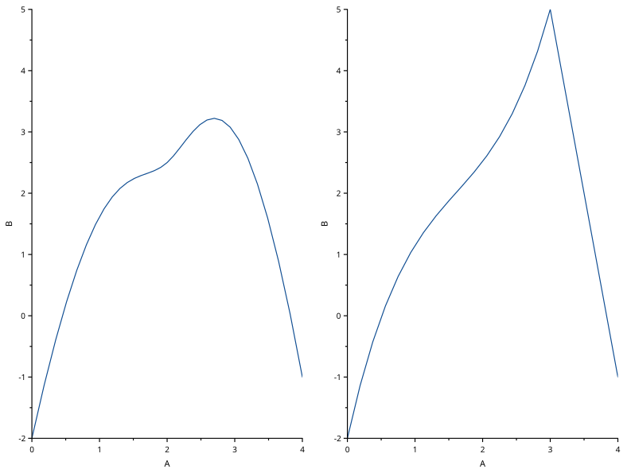
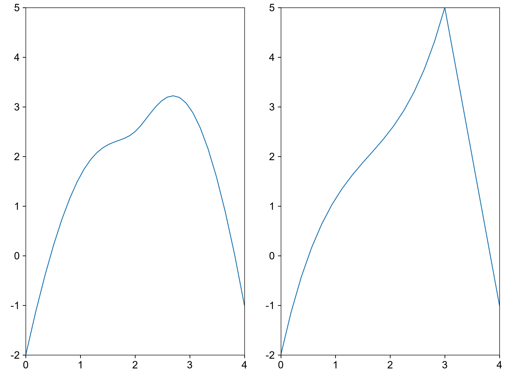

# bspline-bezier

覆盖：F498。数据来源：本仓库自建最小样例，构造见 tests/visual_cases.rs。原始数据、轴范围、时区/类别顺序和图元完整记录在 scicanvas.json。左：B 样条；右：Bezier。SciPy 使用同节点向量 / 分段 Bernstein 多项式。

| SciCanvas | matplotlib |
|---|---|
|  |  |

结论：数据位置与刻度映射一致，visual_compare 按 1e-6 检查；自然样条另按相对 Y 误差 1e-9。图形风格差异见[总说明](../README.md)。复现环境和命令也见总说明。
