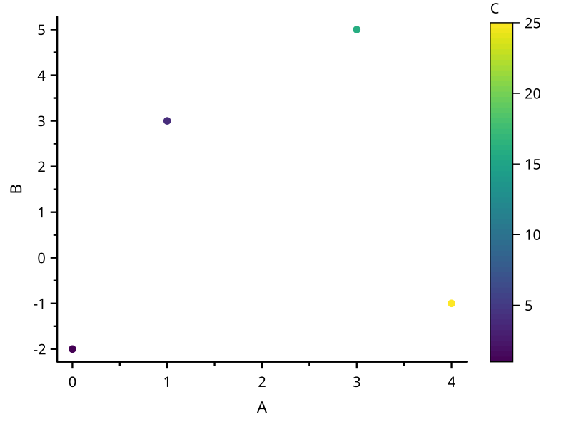
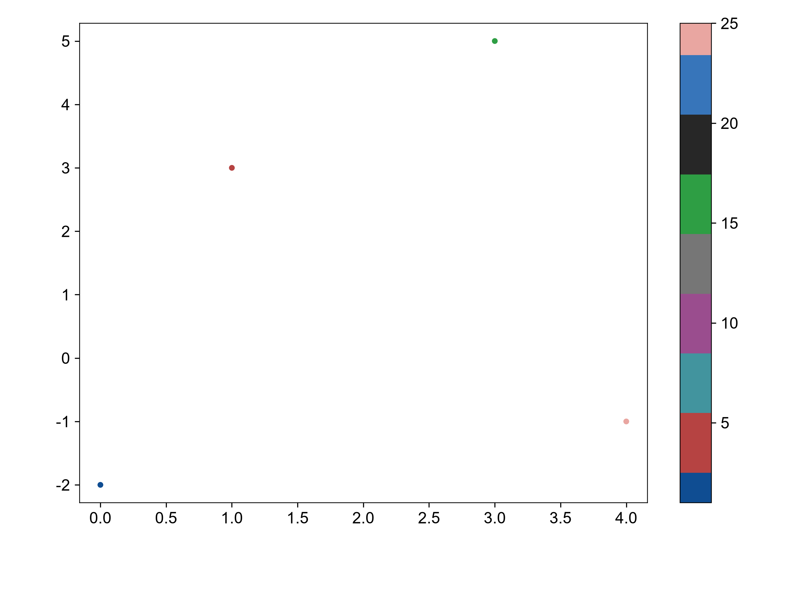

# color-scatter

覆盖：F101、F269。自建共同 X、Y、误差或映射列样例，完整数据与图元见 scicanvas.json，构造见 visual_cases.rs。

| SciCanvas | matplotlib |
|---|---|
|  |  |

参考使用 matplotlib 3.11.2：fill_between、确定性抖动 scatter、面积尺寸映射及 colorbar。visual_compare 比较位置、颜色、相对半径、色阶刻度和 64 段色块（1e-6）。Windows 人工验收待做。
