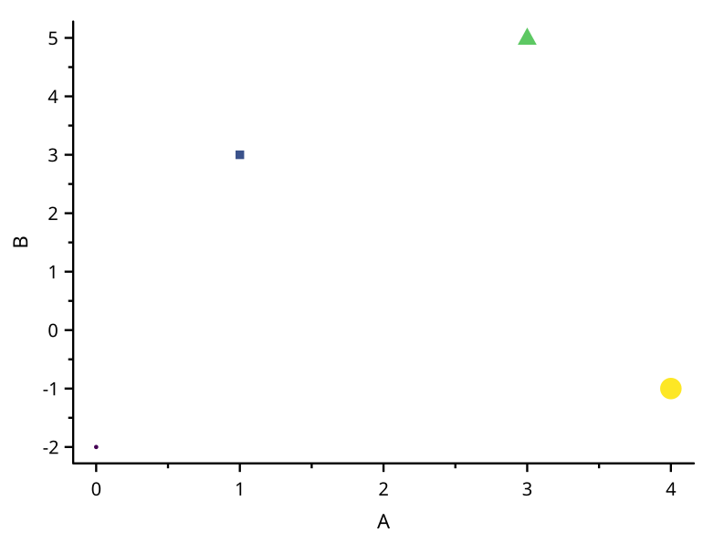
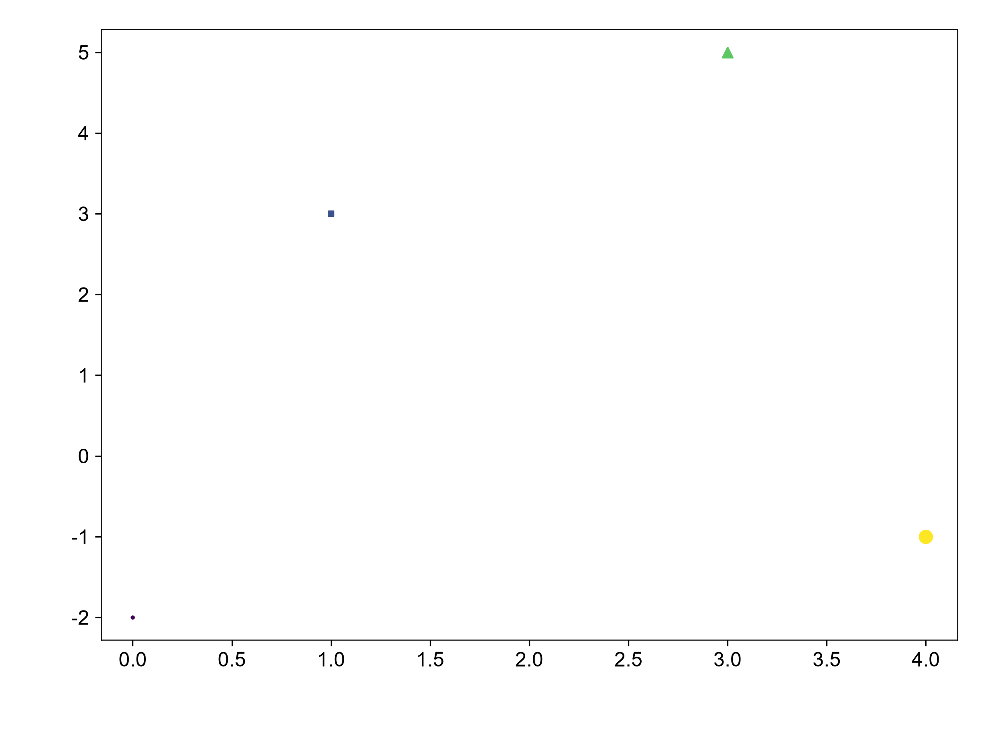

# color-size-shape-map

覆盖：F499, F500, F501。数据来源：本仓库自建最小样例，构造见 tests/visual_cases.rs。原始数据、轴范围、时区/类别顺序和图元完整记录在 scicanvas.json。颜色参考从 Matplotlib 注册表的 viridis 正式 256 级色表读取，先量化为 u8，再用 NumPy 按位置线性插值，匹配连续 RGB 采样约定；不读取 SciCanvas 的色表。使用 Matplotlib Normalize。尺寸与形状在并排图展示，仅核对位置。

| SciCanvas | matplotlib |
|---|---|
|  |  |

结论：数据位置与刻度映射一致，visual_compare 按 1e-6 检查；自然样条另按相对 Y 误差 1e-9。图形风格差异见[总说明](../README.md)。复现环境和命令也见总说明。
