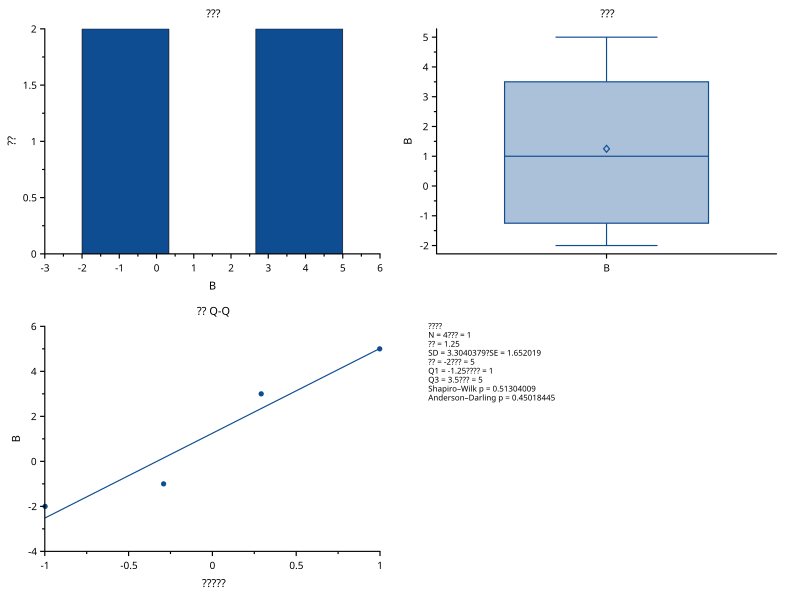
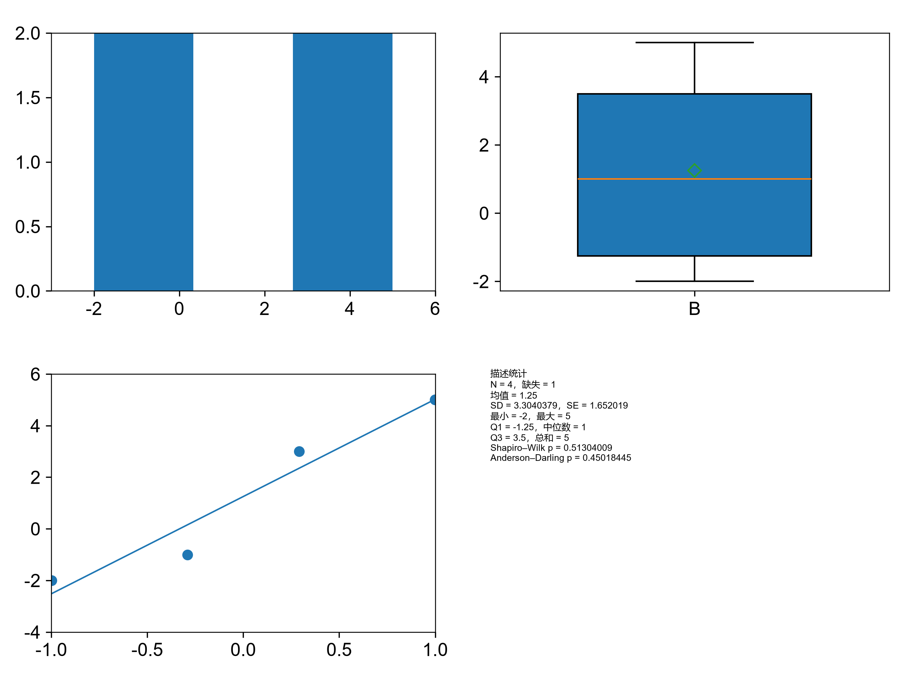

# graphical-summary

覆盖 F505。实际工厂生成三幅统计图及第四象限注释；matplotlib 独立绘制直方图、箱线图和 Q-Q，注释统计量由 NumPy、SciPy 和 statsmodels 从原始数据独立计算。点、线及箱体位置容差 1e-6，统计值另有 NumPy 1e-12 回归。

| SciCanvas | matplotlib |
|---|---|
|  |  |
