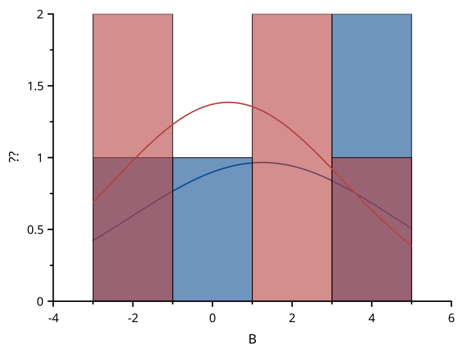
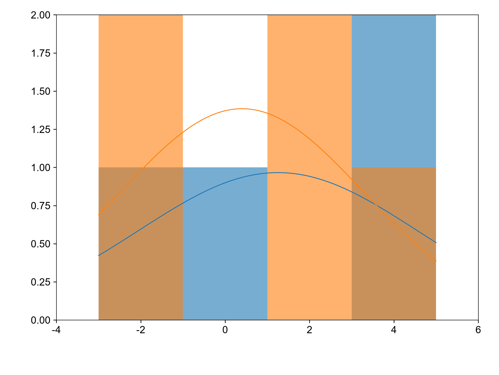

# histogram-options

覆盖：F343。B、C 两列按共同区间分箱，指定宽度为 2，并叠加各列的正态分布曲线。分箱仅依赖有限 Y 值，均值和样本标准差由分箱前的样本计算。

| SciCanvas | matplotlib |
|---|---|
|  |  |

matplotlib 使用相同显式边界调用 numpy.histogram，曲线使用 scipy.stats.norm.pdf，并按 N × 区间宽度缩放至计数尺度。`visual_compare` 按 1e-6 比较柱子中心、高度、曲线采样点和刻度，数值参考另按 1e-12 比较计数与 pdf/cdf 曲线。复现环境与命令见[总说明](../README.md)。
