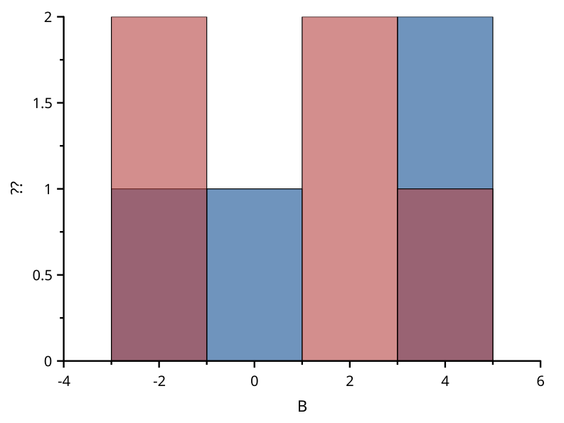
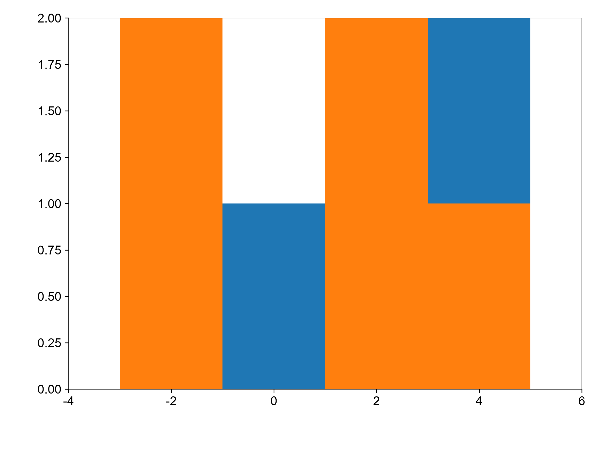

# histogram

覆盖：F343。数据来源：本仓库自建最小样例，构造见 tests/visual_cases.rs（图库预设样例）。B、C 两列的值（B 第 3 行缺失）按共同区间计数：范围取两列全部有效值的最小、最大值，区间数按较长一列用 Sturges 规则；原始数据、轴范围和图元完整记录在 scicanvas.json。matplotlib 用同样的区间调用 numpy.histogram，再画柱子。

| SciCanvas | matplotlib |
|---|---|
|  |  |

结论：各区间柱子的中心位置和高度（计数）一致，visual_compare 按 1e-6 检查。柱宽、颜色和透明度属于风格，不做数值比较；柱子相连由 tests/histogram.rs 检查。图形风格差异见[总说明](../README.md)。复现环境和命令也见总说明。
