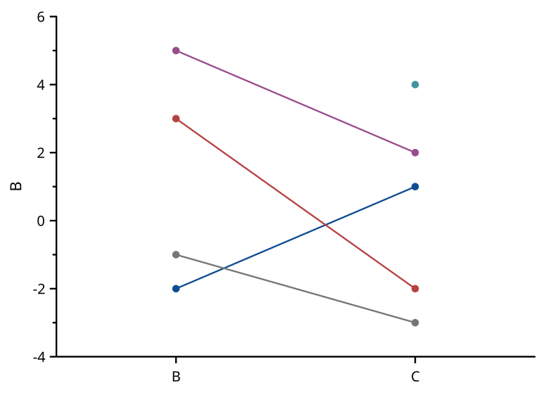
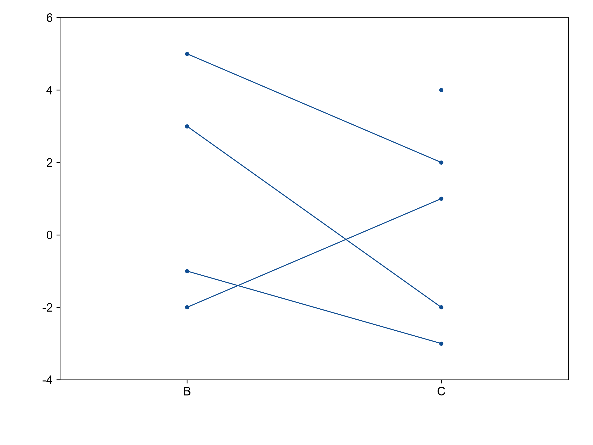

# line-series

覆盖：F275。自建原始数据记录于 scicanvas.json，参考由 NumPy 偏移规则和 matplotlib plot/scatter 生成。

| SciCanvas | matplotlib |
|---|---|
|  |  |

数据位置按 1e-6 对照。偏移、原值拾取和实时行连接另有核心回归。

定义依据：[Origin Line Series Graph](https://docs.originlab.com/origin-help/line-series-graph/)。2017 起支持至少两列，不生成隐藏工作表；按同一原始行跨列连接。
