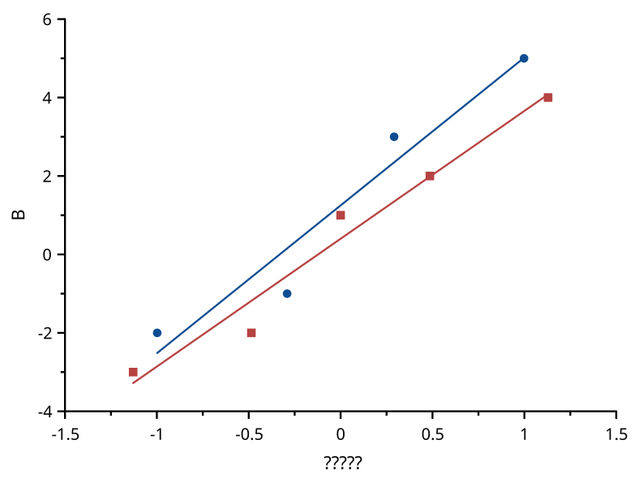
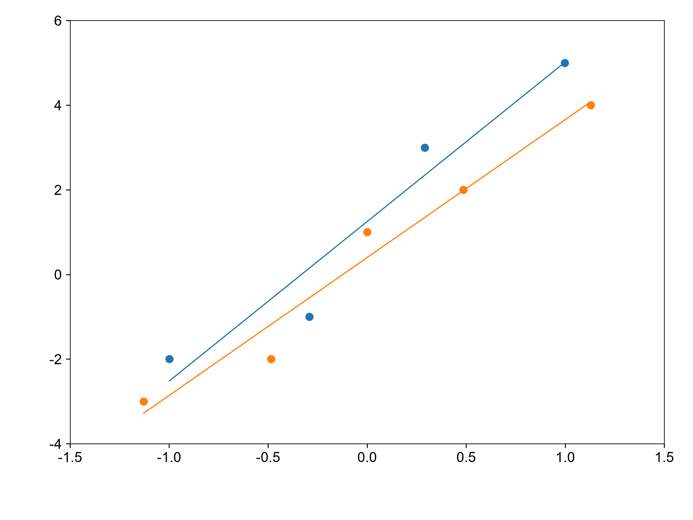

# qq

覆盖：F355。测试的图库样例含两个 Y 列，B 列包含缺失值。每列独立剔除非有限值，使用 Filliben 排序位置生成理论正态分位数，参考线为理论分位数与排序样本的最小二乘直线。

| SciCanvas | matplotlib |
|---|---|
|  |  |

matplotlib 直接使用 SciPy `stats.probplot(dist="norm")` 生成点和参考线。`visual_compare` 按 1e-6 比较框内符号位置、参考线端点和刻度，数值测试另按 1e-12 对照分位数、排序样本、斜率和截距。颜色、符号及线宽按各自风格显示。环境和复现命令见[总说明](../README.md)。
