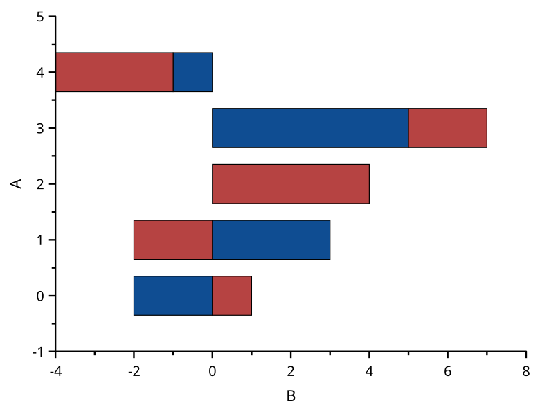
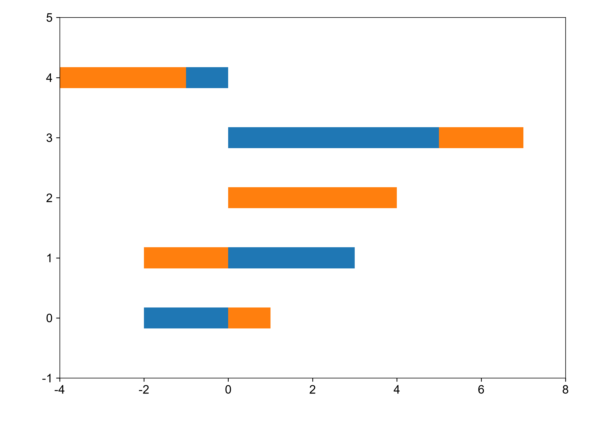

# stacked-horizontal-bar

覆盖：F286。自建共同 X、正负 Y 和缺失行样例，构造见 visual_cases.rs；数据、轴范围及图元见 scicanvas.json。参考由 matplotlib 3.11.2 barh / fill_between 与 NumPy 累计生成。

| SciCanvas | matplotlib |
|---|---|
|  |  |

位置和刻度映射按 1e-6 比较。填充交点和缺失行断开另有核心回归。Windows 人工验收待做。
