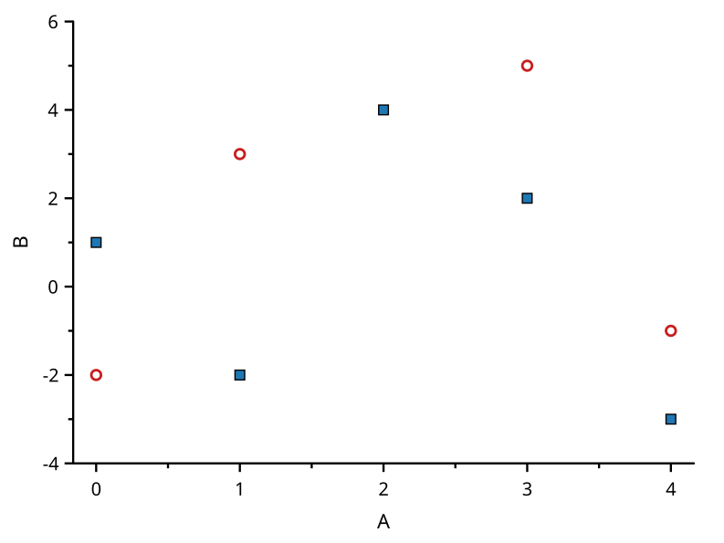
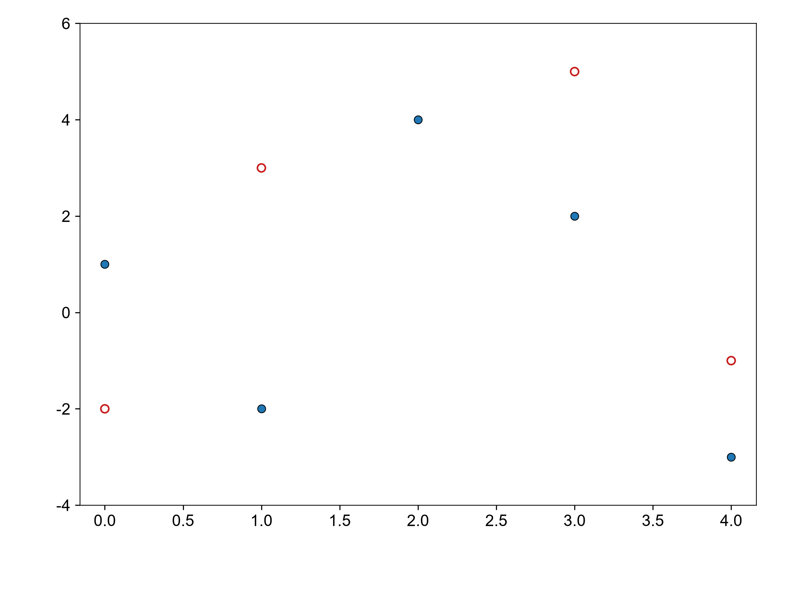

# symbol-fill-border

覆盖：F497。数据来源：本仓库自建最小样例，构造见 tests/visual_cases.rs。B 为空心符号加红色边框（线宽 1.2），C 为自定义蓝色填充（31, 119, 180）加黑色边框；原始数据、轴范围和图元完整记录在 scicanvas.json。

| SciCanvas | matplotlib |
|---|---|
|  |  |

结论：符号位置与内部填充一致（空心记为 null），visual_compare 按 1e-6 检查。边框颜色与线宽只在并排图中展示，不做数值比较。图形风格差异见[总说明](../README.md)。复现环境和命令也见总说明。
